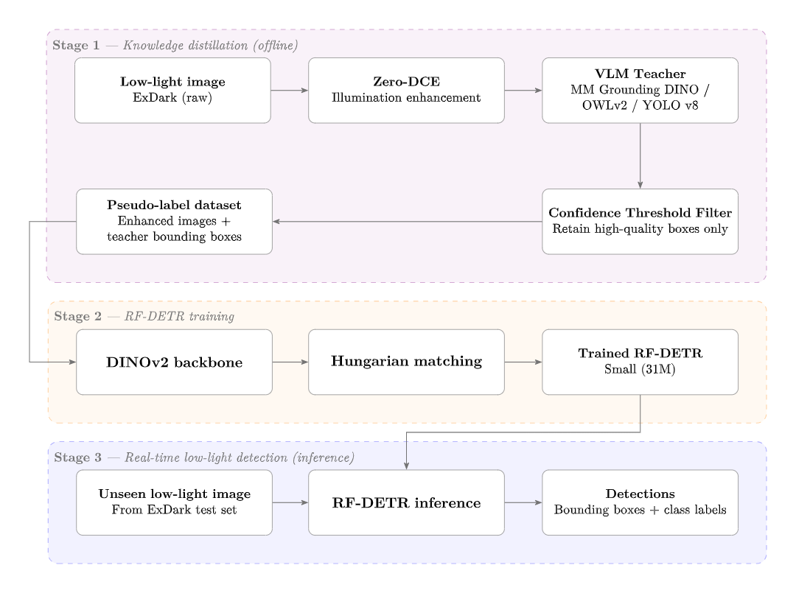
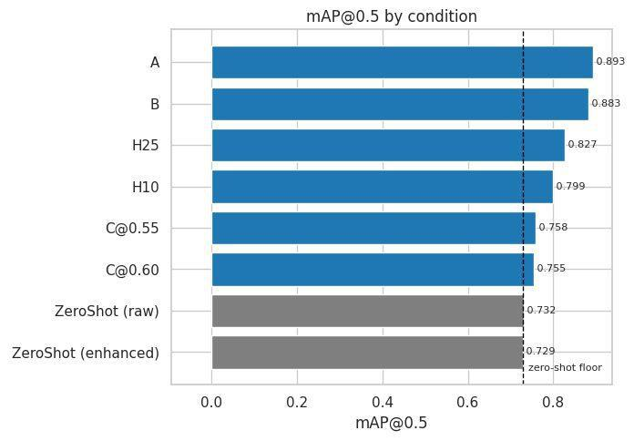

# Robust Low-Light Object Detection: Combining Offline Illumination Compensation, Vision-Language Knowledge Distillation and Real-Time Detection Transformers

Master of Artificial Intelligence research project, Faculty of Computer Science & Information Technology, Universiti Malaya (2026).
**Author:** Law Zhi Xiong

📄 [Thesis (PDF)](report/LawZhiXiong_MAI_Thesis.pdf) · 📊 [Slides](report/LawZhiXiong_MAI_Slides.pptx) · 💾 [Outputs on Google Drive](https://drive.google.com/drive/folders/1bY_TdiijPFT1tV_AcJy-Kt7ab7FsQl-X)

## Overview

Object detectors trained on daytime images lose accuracy in low light, where contrast is reduced, sensor noise rises and illumination is distorted. This project proposes a **decoupled, three-stage pipeline** that trains a real-time detection transformer for low-light scenes **without human annotation**:

1. **Offline knowledge distillation:** ExDark images are enhanced with [Zero-DCE](https://github.com/Li-Chongyi/Zero-DCE). An open-vocabulary VLM teacher (YOLO-World v8, picked from MM Grounding DINO, OWLv2 and YOLO-World) then labels them zero-shot. A per-class confidence threshold keeps only the high-quality boxes as pseudo-labels.
2. **Student training:** [RF-DETR](https://github.com/roboflow/rf-detr) Small (DINOv2 backbone, NMS-free) is trained on the pseudo-label dataset.
3. **Real-time inference:** the trained RF-DETR runs end-to-end on unseen low-light images, with no pre- or post-processing.

Because the stages are decoupled, enhancement, annotation and training can each be varied one at a time and their contributions isolated.



## Dataset

[ExDark](https://github.com/cs-chan/Exclusively-Dark-Image-Dataset) (Loh & Chan, 2019): 7,363 low-light images, 12 classes, 10 lighting conditions. Split 80/10/10, stratified by primary class: 5,886 train / 729 val / 748 test.

## Experimental conditions

| Condition | Training images | Labels |
|---|---|---|
| **A** | Raw | Human |
| **B** | Zero-DCE enhanced | Human |
| **C@0.55 / C@0.60** | Zero-DCE enhanced | VLM pseudo-labels (confidence ≥ 0.55 / 0.60) |
| **H10 / H25** | Zero-DCE enhanced | 90% / 75% pseudo + 10% / 25% human (stratified) |
| **Zero-shot** | Raw / enhanced | None (COCO-pretrained RF-DETR-Small) |

## Results (ExDark test split)

| Run | Images | mAP@0.5 | mAP@[.5:.95] |
|---|---|---|---|
| A | raw | **0.893** | **0.634** |
| B | enhanced | 0.883 | 0.621 |
| H25 | enhanced | 0.827 | 0.479 |
| H10 | enhanced | 0.799 | 0.449 |
| C@0.55 | enhanced | 0.758 | 0.420 |
| C@0.60 | enhanced | 0.755 | 0.416 |
| Zero-shot | raw | 0.732 | 0.402 |
| Zero-shot | enhanced | 0.729 | 0.402 |



**Key findings**
- Pseudo-labels alone (C@0.55, no human annotation) improve on the zero-shot RF-DETR baseline and reach 0.420 mAP@[.5:.95]. That is within 0.001 of the best published ExDark result in the comparison (DeC-YOLO, 0.421).
- Mixing in a small number of human labels closes much of the gap to full supervision. Of the 0.201 mAP@[.5:.95] gap between pseudo-label-only training and human labels on enhanced images, 10% human labels recover 14.5% and 25% recover 29.5%.
- Zero-DCE enhancement gave **no measurable benefit**. A supplementary probe comparing Raw, Zero-DCE, CLAHE and SCI over 3 seeds confirms this, so the enhancement stage can be dropped at deployment.
- Deployment cost: 31.8M parameters, 50.9 GFLOPs, **77.4 FPS**.

## Repository structure

```
├── report/
│   ├── LawZhiXiong_MAI_Thesis.pdf
│   └── LawZhiXiong_MAI_Slides.pptx
├── notebooks/                     # run in this order
│   ├── Phase0_VLM_Teacher_Selection.ipynb                 # teacher comparison & threshold analysis (600-image sample)
│   ├── Phase1_PseudoLabel_Generation.ipynb                # Zero-DCE enhancement + YOLO-World pseudo-labelling
│   ├── Phase2a_RFDETR_Training_Evaluation.ipynb           # Conditions A, B, C@0.55, C@0.60
│   ├── Phase2b_Hybrid_PseudoLabels.ipynb                  # Hybrid conditions H10, H25
│   ├── Phase2c_Probe_Enhancer_Comparison.ipynb            # Raw vs Zero-DCE vs CLAHE vs SCI probe
│   ├── Phase3a_ZeroShot_RFDETR_Baseline_Comparison.ipynb  # Zero-shot RF-DETR baseline
│   └── Phase3b_Efficiency_Metrics.ipynb                   # Params, GFLOPs, FPS
└── assets/                        # figures used in this README
```

## Outputs

Trained weights, pseudo-label sets, enhanced images and evaluation outputs are too large for GitHub. They are on Google Drive:
**https://drive.google.com/drive/folders/1bY_TdiijPFT1tV_AcJy-Kt7ab7FsQl-X**

## Environment

The notebooks were run on Google Colab with a GPU runtime. Each notebook installs its own dependencies in its first cells. The main packages are:
`rfdetr[train,loggers]`, `ultralytics` (YOLO-World v8), `transformers` (MM Grounding DINO, OWLv2), `supervision`, `pycocotools`, `opencv-python-headless`, `fvcore`.

Key settings: seed 42, RF-DETR-Small with COCO-pretrained initialisation, 25 epochs with early stopping, learning rate 1e-4, batch size 16.

## Citation

```
Law, Z. X. (2026). Robust low-light object detection: combining offline illumination
compensation, vision language knowledge distillation and real-time detection transformers
(Master's thesis). Universiti Malaya, Kuala Lumpur.
```

Copyright in the thesis is held by Universiti Malaya.
